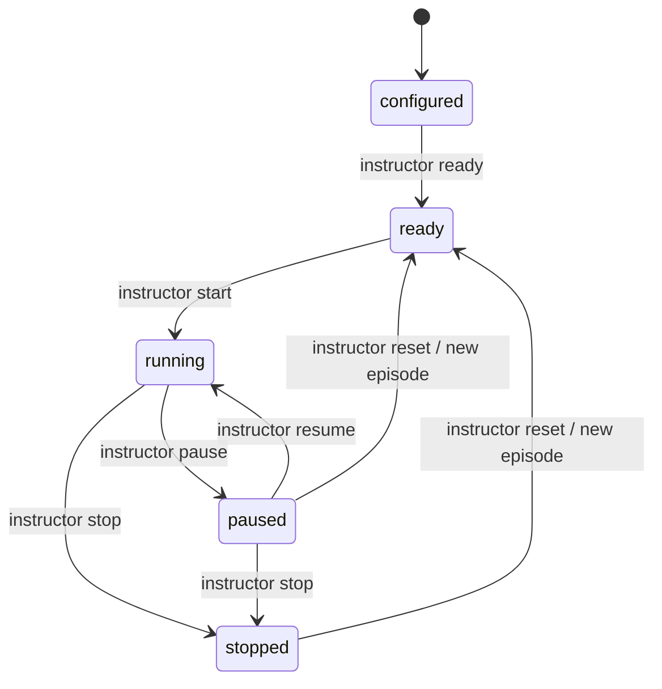

# Civil Navigation Interruption — Instructor and Replay Contract

**Delivery:** scenario draft plus an executable, offline contract checker.
**Version:** 1.0 / scenario revision 1. **Review:** 10 October 2026.

This work completes the proposed task to draft one virtual training scenario
with instructor controls and replay checks. It exercises lifecycle, authority,
cue acknowledgement and reproducible debriefing using synthetic events. The
repository's aircraft dynamics, cockpit, simulator adapters and validated flight
training remain separate workstreams.

## Learning objective and scope

In an instructor-led civilian virtual session, the trainee identifies a simulated
navigation-display interruption, acknowledges the cue and participates in a
reviewable debrief. This is an interaction exercise; it gives no aircraft-specific
operating procedure or proficiency certification. An instructor defines any
future domain assessment after the selected aircraft/model is qualified.

The current model owner, `scripted-source`, advances an integer clock only. There
is no position, attitude, control-response or navigation computation, and no
FlightGear, JSBSim, avionics, hardware, network or language-model connection.
The ENU/SI declarations reserve future interface conventions; no coordinate
transform is tested here. The seed is provenance metadata, not an active random
generator. The two-second fixture is a compact contract example, not the duration
of a realistic lesson.

## Artifacts and provenance

- [Scenario manifest](../../training/scenarios/civil-navigation-interruption-v1.json)
- [Synthetic replay fixture](../../training/fixtures/civil-navigation-interruption-v1.replay.json)
- [Offline checker](../../tools/check_training_replay.py)
- [Contract tests](../../tests/test_training_replay.py)

The manifest has an exact version-1 field set: identity/revision, seed, execution
profile, dynamics owner, frame/units, integer tick, initial state, allowed cues,
required acknowledgements and expected action sequence. It is pinned by a SHA-256
digest of sorted, compact JSON with non-finite numbers disallowed. Changing the
scenario requires regenerating and reviewing its fixture and expected result.

Every event contains exactly `event_id`, `sequence`, `episode`, `sim_time_s`,
`producer`, `action` and `payload`. IDs are unique; sequence starts at one and is
contiguous. Event time is the clock **before** the action; a successful step then
advances it. No wall clock is used. Reset increments episode, returns the clock
to zero and clears cue/acknowledgement state without discarding prior events.

## Instructor controls and ownership

| Action | Producer | Precondition | Result |
| --- | --- | --- | --- |
| `ready` | instructor | configured | ready |
| `start` | instructor | ready | running |
| `pause` | instructor | running | paused; steps rejected |
| `resume` | instructor | paused | running |
| `inject_cue` | instructor | running or paused | Add one declared cue; reject duplicates |
| `reset` | instructor | paused or stopped | ready, new episode, clear cues |
| `stop` | instructor | running or paused | stopped; retain debrief history |
| `step` | scripted-source | running | Advance by the manifest tick |
| `acknowledge` | trainee | running, cue already injected | Record one acknowledgement |

Lifecycle payloads are empty. Step payload is `{"dt_s": 1}` for this manifest;
cue actions use `{"cue": "navigation-display-unavailable"}`. Producers are
validated labels in an offline artifact, not authenticated users or a deployed
Instructor API. An adapter must later bind identities and permissions explicitly.

## Baseline scenario script

| Sequence | Time before action (s) | Actor / action | Expected state after action |
| --- | ---: | --- | --- |
| 1 | 0 | instructor: ready | ready |
| 2 | 0 | instructor: start | running |
| 3 | 0 | scripted-source: step | running, time 1 |
| 4 | 1 | instructor: pause | paused, time 1 |
| 5 | 1 | instructor: inject navigation-display-unavailable | paused, cue active |
| 6 | 1 | instructor: resume | running |
| 7 | 1 | trainee: acknowledge cue | running, acknowledgement recorded |
| 8 | 1 | scripted-source: step | running, time 2 |
| 9 | 2 | instructor: stop | stopped |



## Debrief and acceptance criteria

The checker rebuilds the lifecycle/cue trace and compares its digest and final
summary against the reviewed fixture. Exact equality is appropriate for this
integer synthetic contract; a physics adapter must declare its own numerical
tolerances and cannot reuse this claim as evidence of deterministic physics.
These hashes detect accidental changes relative to a trusted reference; they
are not signatures or protection against someone rewriting both the data and
expected checksums.

| Requirement | Acceptance evidence |
| --- | --- |
| JTS-TR-01: instructor retains lifecycle control | A trainee pause is rejected |
| JTS-TR-02: pause freezes simulated time | A step while paused is rejected |
| JTS-TR-03: cue acknowledgement has provenance | Unknown/uninjected cues are rejected |
| JTS-TR-04: replay preserves identity and order | Duplicate IDs, sequence gaps and timestamp drift are rejected |
| JTS-TR-05: reset creates a clean episode | Reset test clears cues/time and rejects stale episode IDs |
| JTS-TR-06: debrief is reproducible | Two runs match the golden summary and trace digest |
| JTS-TR-07: incomplete sessions cannot pass baseline replay | Missing stop or unexpected sequence is rejected |

`objective_met` only reports whether required cue acknowledgements occurred in
the final episode. A valid replay may report `false`; this is not a pilot skill
score. The expected baseline is nine events, episode zero, stopped at two seconds,
with the declared cue acknowledged. Golden trace SHA-256:
`abb83282ff05a12c46dfc95313164700d22b397b7cf74d2d36158bb28c5d02d8`.

## Run the checks

From the repository root, using Python 3.11 or newer and the standard library:

```bash
python tools/check_training_replay.py training/scenarios/civil-navigation-interruption-v1.json training/fixtures/civil-navigation-interruption-v1.replay.json
python -m unittest discover -s tests -v
```

The checker prints the debrief JSON and exits zero on equality; it exits nonzero
on contract rejection. It reads local artifacts and does not contact a service.
The commands and 13 tests were executed during this delivery; the local runtime
version is recorded in the [validation report](validation-2026-10-10.md).

## AI assistance and next delivery

AI assisted the draft scenario, contract implementation, tests and documentation.
AI has no runtime control role in this baseline. A future debrief assistant may
consume the reviewed trace and propose instructor notes, with no permission to
alter assessment evidence or issue simulator commands.

**Next proposed task:** implement and test a local flight-dynamics adapter for one
qualified civilian aircraft/model, including pinned model provenance, SI/frame
mapping, instructor pause/reset and a recorded replay with declared tolerances.
Choose the engine and model through the existing source/model gates before
claiming FlightGear or JSBSim integration. This delivery does not complete the
Minimal Flight Twin, Instructor API, scoring interface or distributed recorder.
